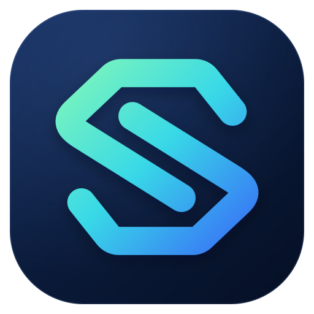

<div align="center">



# Sub2API Next

**更適合外接 API 的 Sub2API 版本**

[](https://github.com/LLJ99999/sub2api-next/actions/workflows/backend-ci.yml)
[](https://github.com/LLJ99999/sub2api-next/pkgs/container/sub2api-next)
[](https://golang.org/)
[](https://vuejs.org/)
[](https://www.postgresql.org/)
[](https://redis.io/)
[](LICENSE)

由 [api.zhigeng.io](https://api.zhigeng.io/) 維護

[简体中文](README.md) | [English](README_EN.md) | 繁體中文

</div>

---

## 簡介

Sub2API Next 是更適合**外接 API 上游**（其他中轉站、官方 API Key）的 Sub2API 版本。外接 API 帳號使用獨立的熔斷、冷卻與維運策略，**與帳號池隔離**：帳號池原有能力（OAuth、品質維運、Mihomo 出口、Excel / BPS 等）完整保留、互不干擾。

## 核心能力

### 🛡️ 外接 API 排程與容錯

- **熔斷器**：以滑動視窗統計上游錯誤，達到閾值才熔斷，按模型隔離；半開狀態最多放行 2 個探測請求，反覆失敗指數退避。
- **402 可恢復冷卻**：上游餘額不足時冷卻 30 分鐘後自動恢復；OpenAI `deactivated_workspace` 仍永久停用。
- **成功自愈**：API Key 帳號請求成功後自動清除殘留冷卻。
- **全冷卻備援**：所有候選帳號都在冷卻時執行受控半開探測，而非直接回傳 503。
- **故障轉移時間預算**：限制單次請求的總重試時長。

管理端可直接看到冷卻原因、狀態碼、剩餘時間和熔斷等級，支援一鍵恢復；每個帳號可單獨開關 `upstream_relay_policy`。
→ [上游中轉韌性說明](docs/upstream-relay-resilience.zh-TW.md)

### 📊 使用記錄與報表

- **TPS、快取命中率**獨立成欄，支援伺服器端排序；類型徽章下直接顯示快取率與 TPS。
- **上游成本一鍵隱藏**：表格、tooltip、統計卡、匯出同步隱藏，方便截圖。
- **多維度彙總報表**：按帳號 / 分組 / 模型檢視 TTFT 與 TPS 的 P50/P95、錯誤數、收入、上游成本、**毛利與毛利率**。

→ [使用分析說明](docs/usage-analytics.zh-TW.md)

### 🔭 上游維運

- **倍率 / 餘額變化警示**：自動記錄上游倍率與餘額歷史，支援合併視窗、漲跌方向過濾、按帳號靜音，並發送通知。→ [說明](docs/upstream-change-alerts.zh-TW.md)
- **上游品質實測**：按帳號直連上游發極小的流式請求，測 TTFT、輸出 TPS、真實 token 用量與上游實際模型名。預設關閉，按帳號開啟。→ [說明](docs/upstream-quality-probes.zh-TW.md)
- **公開中轉快照**：透過 `/.well-known/ai-transit.json`、`/api/public/transit/v1/snapshot` 和 `/public/transit` 對外展示分組、價格與可用率，只輸出彙總後的匿名資料。→ [說明](docs/public-transit-snapshot.zh-TW.md)
- **從上游拉取模型**：模型輸入框旁一鍵拉取上游 `/v1/models`，可搜尋點選；支援依帳號、依分組或尚未儲存的草稿憑證拉取。透傳模式下 `/v1/models` 也會直接查詢上游。
- **探測提示詞輪替**：鵜鶘測試與上游品質實測可設定多條提示詞（`prompts[]`）輪流使用。→ [鵜鶘測試說明](docs/pelican-scheduled-tests.zh-TW.md)
- **帳號頁批次開關**：在帳號列表批次開啟 / 關閉上游計費探測與品質實測，同一 Base URL 自動去重。

### 🔧 其他改進

- **儲值頁多分頁**：自訂名稱、排序的儲值分頁，各自綁定付款方式；附透過 EasyPay 串接幣安支付的說明。→ [說明](docs/recharge-tabs.zh-TW.md)
- **側邊欄自訂**：系統設定 → 側邊欄版面，可顯示 / 隱藏入口、自建群組、調整順序，版面儲存在伺服器端。
- 持續合入上游 OpenAI / ChatGPT 通道修正，包括串流容錯移轉、工具呼叫路由、快取計費明細等。
- 支援 **Cap 自建驗證碼**（`cap:<key>` 或 `cap:<base>|<key>`），CSP 已放行 `'wasm-unsafe-eval'`。
- 監控分組按 平台順序 → `sort_order` → 請求量 排序。
- 監控快取率不再把零快取請求計入分母，Token / TPM 統計不受影響；附[歷史資料重算 SQL](docs/sql/channel_monitor_v2_recompute_cache.sql)。

## 快速開始

預先建置的映像檔由 GitHub Actions 自動發布到 GHCR，支援 `linux/amd64` 與 `linux/arm64`：

```bash
docker pull ghcr.io/llj99999/sub2api-next:latest
```

| 標籤 | 說明 |
| --- | --- |
| `latest` / `main` | `main` 分支最新建置 |
| `sha-<短雜湊>` | 指定提交，方便固定版本與回滾 |
| `<版本號>` | 推送 `v*` 標籤時發布 |

使用 Docker Compose 部署（`deploy/docker-compose.yml` 已指向上述映像檔）：

```bash
git clone https://github.com/LLJ99999/sub2api-next.git
cd sub2api-next/deploy
cp .env.example .env   # 至少設定 POSTGRES_PASSWORD
docker compose up -d
```

詳細設定見 [部署說明](deploy/README.md)。首次啟動若未指定管理員帳號，會在啟動日誌 `Generated admin` 中輸出隨機電子郵件和密碼。也可以自行建置：`docker build -t sub2api-next:latest .`

**從上游版本升級**：備份資料庫後替換映像檔重啟即可。啟動時自動執行新增遷移 `310`（上游變化歷史）、`311`（品質實測）、`320`（快取率計算方式）、`321` / `322`（探測提示詞輪替）。

更多文件：[新人入門](docs/新人入門.md) · [品質維運](docs/account-quality-operations.md) · [Excel / BPS](docs/excel-bps.md) · [支付設定](docs/PAYMENT_CN.md)

## 技術堆疊

| 元件 | 技術 |
| --- | --- |
| 後端 | Go 1.27.3 · Gin · Ent |
| 前端 | Vue 3 · Vite · TailwindCSS |
| 儲存 | PostgreSQL 15+ · Redis 7+ |
| 協定 | OpenAI Responses / Chat Completions · Anthropic Messages · Gemini · SSE · WebSocket |
| 交付 | Docker Compose · GitHub Actions（Go 單元測試 / 整合測試 / golangci-lint / 前端測試 / wire 校驗）· GHCR 多架構映像檔 |

## 已知限制

- 上游品質實測暫不支援 Gemini / Antigravity。
- 故障轉移時間預算尚未覆蓋 Grok 媒體、圖片和 embeddings 等少數重試迴圈。
- 半開探測遇到 400 時，探測槽位可能保留到安全過期時間才釋放。

## 專案來源

`Wei-Shaw/sub2api` → `ranxi2001/sub2api` → **`LLJ99999/sub2api-next`**

感謝 [Wei-Shaw/sub2api](https://github.com/Wei-Shaw/sub2api) 與 [ranxi2001/sub2api](https://github.com/ranxi2001/sub2api) 及其貢獻者的工作。原有功能（多帳號管理、計費、並行控制、支付、管理後台等）的完整說明請參考上游文件。

## 貢獻

歡迎 Issue 與 PR。提交時請說明影響的請求路徑、帳號類型、預設值和相容性，並附上實際執行過的測試。**不要提交 Token、OAuth 匯出、代理憑證或任何正式環境設定。**

## ⚠️ 免責宣告

- 使用本專案可能違反 Anthropic、OpenAI 等上游服務商的服務條款，風險由使用者自行承擔。
- 請在遵守所在地法律法規的前提下使用，嚴禁用於違法用途。
- 本專案僅供技術學習與研究，作者不對帳號封禁、服務中斷、資料遺失等任何損失負責。

## 授權條款

[GNU 較寬鬆公共授權條款（LGPL）v3.0](LICENSE)（或更高版本），沿用上游授權。
